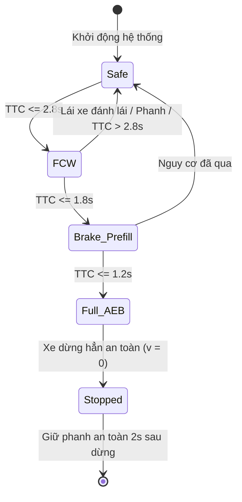
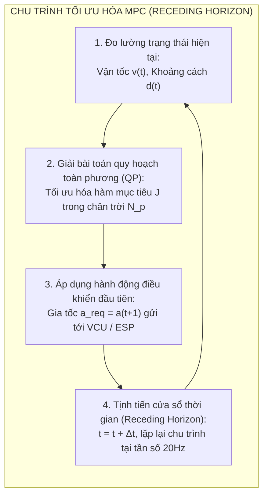
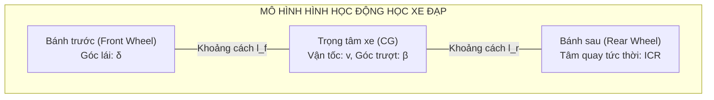
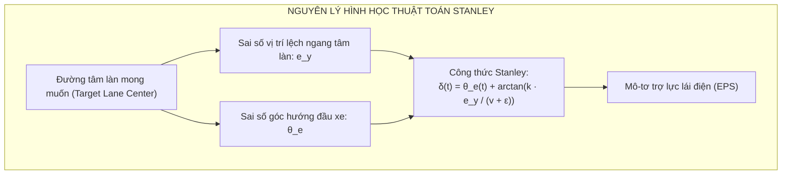
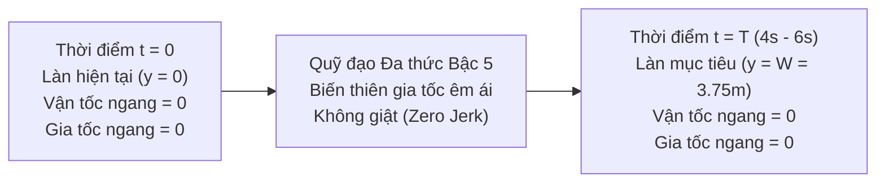

# CHƯƠNG 3: CÁC TÍNH NĂNG ADAS CỐT LÕI & THUẬT TOÁN ĐIỀU KHIỂN

---

## 1. ĐIỀU KHIỂN DỌC: PHANH KHẨN CẤP (AEB) & GA THÍCH ỨNG (ACC)

Điều khiển dọc (Longitudinal Control) chịu trách nhiệm quản lý gia tốc dương (tăng tốc) và gia tốc âm (phanh giảm tốc) của xe để duy trì vận tốc cài đặt và khoảng cách an toàn với chướng ngại vật phía trước.

```mermaid
flowchart LR
    subgraph INPUTS["TÍN HIỆU ĐẦU VÀO"]
        VSET["Vận tốc cài đặt: v_set"]
        DIST["Khoảng cách đo: d_rel"]
        VLEAD["Vận tốc xe trước: v_lead"]
    end

    subgraph CONTROLLER["BỘ ĐIỀU KHIỂN DỌC (LONGITUDINAL CONTROLLER)"]
        ALGO["Thuật toán Điều khiển<br/>(MPC / PID)"]
        AREQ["Gia tốc yêu cầu:<br/>a_req"]
        ALGO --> AREQ
    end

    subgraph ARBITER["BỘ PHÂN CHIA QUYỀN LỰC (ARBITER)"]
        CHECK{"Kiểm tra a_req"}
    end

    subgraph ACTUATORS["CƠ CẤU CHẤP HÀNH (ACTUATION)"]
        VCU["Hệ truyền động Điện (VCU / Inverter)<br/>Mô-men kéo Motor (a_req > 0)"]
        ESP["Hệ thống Phanh Điện tử (ESP / iBooster)<br/>Áp suất dầu phanh (a_req < 0)"]
    end

    VSET & DIST & VLEAD --> ALGO
    AREQ --> CHECK
    CHECK -->|a_req > 0 (Tăng tốc)| VCU
    CHECK -->|a_req < 0 (Phanh giảm tốc)| ESP

    classDef in fill:#e1f5fe,stroke:#0288d1,stroke-width:2px;
    classDef ctrl fill:#f3e5f5,stroke:#7b1fa2,stroke-width:2px;
    classDef arb fill:#fff3e0,stroke:#f57c00,stroke-width:2px;
    classDef act fill:#e8f5e9,stroke:#388e3c,stroke-width:2px;
    class VSET,DIST,VLEAD in;
    class ALGO,AREQ ctrl;
    class CHECK arb;
    class VCU,ESP act;
```

---

### 1.1. Phanh Khẩn Cấp Tự Động (AEB - Autonomous Emergency Braking)

#### 1. Công thức Toán học Tính toán Thời gian tới Va chạm (TTC)

Chỉ số Thời gian tới Va chạm (**Time-to-Collision - TTC**) là thông số vật lý quan trọng nhất quyết định kích hoạt cảnh báo va chạm phía trước (FCW) hoặc phanh tự động khẩn cấp (AEB).

##### Trường hợp 1: Vận tốc Tương đối Ổn định (Constant Relative Velocity)

Khi xe phía trước chạy với vận tốc không đổi hoặc đứng yên, chuyển động tương đối được xem là chuyển động thẳng đều:

$$
\text{TTC} = \frac{d_{rel}}{-v_{rel}} = \frac{x_{lead} - x_{ego}}{v_{ego} - v_{lead}} \quad (v_{ego} > v_{lead})
$$

##### Trường hợp 2: Xe Phía trước Đang Phanh Gấp (Có Gia tốc Tương đối $a_{rel}$)

Khi xe đi trước đạp phanh đột ngột với gia tốc hãm, ta thiết lập phương trình chuyển động tương đối có gia tốc:

$$
d_{rel} + v_{rel} \cdot t + \frac{1}{2} a_{rel} \cdot t^2 = 0
$$

Giải phương trình bậc hai theo thời gian $t$, nghiệm dương nhỏ nhất chính là thời gian va chạm chính xác:

$$
\text{TTC}_{accel} = \frac{-v_{rel} - \sqrt{v_{rel}^2 - 2 a_{rel} d_{rel}}}{a_{rel}}
$$

##### Bảng Giải thích Chi tiết Các Đại lượng trong Công thức TTC:

| Đại lượng | Ký hiệu | Đơn vị | Ý nghĩa & Vai trò Kỹ thuật trong Hệ thống ADAS |
| :--- | :--- | :--- | :--- |
| $\text{TTC}$ | Time-to-Collision | $\text{s}$ (giây) | Thời gian ước lượng còn lại trước khi xe chủ đâm vào đuôi xe trước nếu giữ nguyên trạng thái vận tốc. |
| $\text{TTC}_{accel}$ | Accelerated TTC | $\text{s}$ (giây) | Thời gian va chạm khi xét đến gia tốc tương đối giữa 2 xe (đặc biệt khi xe trước phanh gấp). |
| $d_{rel}$ | Relative Distance | $\text{m}$ (mét) | Khoảng cách tương đối dọc trục giữa mũi xe chủ và đuôi xe đi trước ($d_{rel} = x_{lead} - x_{ego}$). |
| $v_{rel}$ | Relative Velocity | $\text{m/s}$ | Vận tốc tương đối ($v_{rel} = v_{lead} - v_{ego}$). Khi xe chủ chạy nhanh hơn xe trước, $v_{rel} < 0$. |
| $a_{rel}$ | Relative Acceleration | $\text{m/s}^2$ | Gia tốc tương đối ($a_{rel} = a_{lead} - a_{ego}$). Khi xe trước phanh gấp còn xe chủ chưa phanh, $a_{rel} < 0$. |
| $x_{lead}, x_{ego}$ | Absolute Positions | $\text{m}$ | Tọa độ vị trí dọc trục tuyệt đối của xe đi trước (Lead) và xe chủ (Ego) trên làn đường. |
| $v_{lead}, v_{ego}$ | Absolute Velocities | $\text{m/s}$ | Vận tốc di chuyển tuyệt đối của xe đi trước và xe chủ. |
| $a_{lead}, a_{ego}$ | Absolute Accelerations | $\text{m/s}^2$ | Gia tốc di chuyển tuyệt đối của xe đi trước và xe chủ. |
| $v_{rel}^2 - 2 a_{rel} d_{rel}$ | Biểu thức dưới căn | $\text{m}^2/\text{s}^2$ | Biệt thức xác định nguy cơ va chạm. Nếu $< 0$, hai xe không có nghiệm cắt nhau (không xảy ra va chạm vật lý). |

---

#### 2. Máy Trạng thái Phanh Khẩn cấp (AEB State Machine)

Hệ thống AEB trên VinFast VF 8 phân chia quy trình can thiệp theo 4 giai đoạn nghiêm ngặt để đảm bảo an toàn tối đa nhưng không gây hoảng loạn cho người lái:



| Giai đoạn | Điều kiện Kích hoạt | Hành vi Hệ thống | Cơ cấu Chấp hành (Actuator) |
| :--- | :--- | :--- | :--- |
| **1. Safe (Bình thường)** | $\text{TTC} > 2.8\text{s}$ | Giám sát thụ động, tính toán quỹ đạo liên tục. | Không can thiệp cơ cấu phanh. |
| **2. FCW (Cảnh báo)** | $1.8\text{s} < \text{TTC} \le 2.8\text{s}$ | Phát âm thanh tít tít dồn dập, chớp nháy biểu tượng đỏ trên màn hình trung tâm & kính lái HUD. | Cụm màn hình HUD, loa cảnh báo buồng lái. |
| **3. Brake Prefill & HBA** | $1.2\text{s} < \text{TTC} \le 1.8\text{s}$ | Nhấp phanh nhẹ (*Brake Jerk*), ép sát má phanh vào đĩa để triệt tiêu độ trễ thủy lực. | Bơm thủy lực ESP tạo áp suất mồi $2 - 5\text{ bar}$. |
| **4. Full AEB (Phanh khẩn cấp)** | $\text{TTC} \le 1.2\text{s}$ | Phanh khẩn cấp cấp độ tối đa ($a \approx -9.8\text{ m/s}^2 \approx -1.0g$) để dừng xe hoặc giảm thiểu chấn thương. | Bộ trợ lực phanh điện tử iBooster / ESP kích hoạt $100\%$. |

---

### 1.2. Kiểm Soát Hành Trình Thích Ứng (ACC - Adaptive Cruise Control)

ACC duy trì một khoảng cách an toàn phụ thuộc vào vận tốc xe (*Constant Time Gap Spacing Policy*):

$$
d_{des}(t) = d_0 + \tau \cdot v(t)
$$

##### Bảng Giải thích Chi tiết Đại lượng:

| Ký hiệu | Tên gọi Kỹ thuật | Đơn vị | Ý nghĩa & Giá trị Tiêu chuẩn trên Xe |
| :--- | :--- | :--- | :--- |
| $d_{des}(t)$ | Desired Following Distance | $\text{m}$ | Khoảng cách bám đuôi mong muốn lý tưởng mà hệ thống ACC cần duy trì tại thời điểm $t$. |
| $d_0$ | Standstill Distance | $\text{m}$ | Khoảng cách an toàn tối thiểu khi cả 2 xe dừng hẳn (thường cài đặt $2.0\text{m} - 3.0\text{m}$). |
| $\tau$ | Time Gap Setting | $\text{s}$ | Khoảng đệm thời gian an toàn do người lái chọn qua nút bấm vô lăng ($1.0\text{s}, 1.4\text{s}, 1.8\text{s}, 2.2\text{s}$). |
| $v(t)$ | Ego Vehicle Speed | $\text{m/s}$ | Vận tốc tức thời hiện tại của xe chủ. |

---

#### Ứng dụng Bộ Điều khiển Dự báo Mô hình (MPC - Model Predictive Control)

Trong khi các hệ thống thế hệ cũ dùng bộ điều khiển PID thuần túy (dễ bị vọt lố overshoot và phanh giật), **VinFast VF 8 / VF 9 ứng dụng bộ điều khiển MPC** để tối ưu hóa đồng thời tính an toàn, sự êm dịu và hiệu suất năng lượng.



##### 1. Hàm Mục tiêu Tối ưu hóa (Cost Function) trong Chân trời Dự báo $N_p$:

$$
\min_{\Delta u} J = \sum_{k=1}^{N_p} \left[ w_d \cdot (d(t+k) - d_{des}(t+k))^2 + w_v \cdot (v(t+k) - v_{set})^2 + w_a \cdot a(t+k)^2 + w_j \cdot \left(\frac{a(t+k) - a(t+k-1)}{\Delta t}\right)^2 \right]
$$

##### 2. Các Ràng buộc Vật lý (Physical Constraints):

* **Giới hạn gia tốc an toàn:** $-3.5\text{ m/s}^2 \le a(t) \le 2.0\text{ m/s}^2$
* **Giới hạn độ giật (Jerk Limit):** $|\text{Jerk}| \le 2.5\text{ m/s}^3$ (Đảm bảo độ êm dịu, chống say xe)
* **Giới hạn khoảng cách:** $d(t) \ge d_{min} > 0$

##### Bảng Giải thích Chi tiết Các Thành phần trong Hàm Mục tiêu MPC:

| Ký hiệu | Tên gọi Kỹ thuật | Đơn vị | Ý nghĩa & Vai trò trong Điều khiển Tối ưu |
| :--- | :--- | :--- | :--- |
| $J$ | Cost Function (Hàm chi phí) | - | Đại lượng tổng hợp sai số phạt cần được bộ giải tối ưu hóa (QP Solver) giảm thiểu tối đa. |
| $N_p$ | Prediction Horizon | Bước | Chân trời dự báo (số bước thời gian tương lai mà MPC mô phỏng, thường $N_p = 20 - 40$ bước). |
| $k$ | Prediction Step Index | Bước | Chỉ số bước thời gian trong tương lai ($k = 1, 2, \dots, N_p$). |
| $d(t+k)$ | Predicted Distance | $\text{m}$ | Khoảng cách dự đoán giữa xe chủ và xe phía trước tại bước $t+k$. |
| $d_{des}(t+k)$ | Desired Distance | $\text{m}$ | Khoảng cách bám đuôi mong muốn lý tưởng tại bước $t+k$. |
| $v(t+k)$ | Predicted Velocity | $\text{m/s}$ | Vận tốc dự đoán của xe chủ tại bước $t+k$. |
| $v_{set}$ | Set Cruising Speed | $\text{m/s}$ | Vận tốc hành trình do người lái thiết lập (ví dụ: $100\text{ km/h}$). |
| $a(t+k)$ | Control Acceleration | $\text{m/s}^2$ | Gia tốc điều khiển dự tính áp dụng tại bước $t+k$. |
| $\frac{a(t+k) - a(t+k-1)}{\Delta t}$ | Jerk (Độ giật) | $\text{m/s}^3$ | Tốc độ biến thiên gia tốc theo thời gian; giá trị càng nhỏ xe chạy càng êm. |
| $\Delta t$ | Sampling Time | $\text{s}$ | Chu kỳ lấy mẫu điều khiển (thường là $0.05\text{s} - 0.1\text{s}$, tương đương tần số $10 - 20\text{Hz}$). |
| $w_d$ | Distance Tracking Weight | - | Trọng số ưu tiên giữ đúng khoảng cách an toàn (tăng cao khi chạy gần xe trước). |
| $w_v$ | Speed Tracking Weight | - | Trọng số ưu tiên bám đúng vận tốc cài đặt (tăng cao khi đường phía trước thông thoáng). |
| $w_a$ | Acceleration Weight | - | Trọng số tiết kiệm năng lượng, hạn chế ga phanh thốc không cần thiết. |
| $w_j$ | Comfort / Jerk Weight | - | Trọng số chống giật, đảm bảo sự êm ái chuẩn xe điện hạng sang cho hành khách. |

---

## 2. ĐIỀU KHIỂN NGANG: GIỮ LÀN (LKA), ĐỊNH TÂM LÀN (LCA) & CHUYỂN LÀN

Điều khiển ngang (Lateral Control) kiểm soát góc quay bánh xe trước $\delta$ thông qua hệ thống Trợ lực lái Điện tử (EPS - Electric Power Steering) để giữ xe bám sát quỹ đạo tâm làn đường.

---

### 2.1. Mô hình Động học Xe Đạp (Kinematic Bicycle Model)

Để thiết kế thuật toán điều khiển góc lái ở dải vận tốc thông thường, phương tiện được đơn giản hóa thành mô hình 2 bánh chuyển động trên mặt phẳng:



##### Hệ Phương trình Trạng thái Động học:

$$
\dot{x} = v \cos(\psi + \beta)
$$

$$
\dot{y} = v \sin(\psi + \beta)
$$

$$
\dot{\psi} = \frac{v}{L} \cos(\beta) \tan(\delta)
$$

$$
\beta = \arctan\left(\frac{l_r}{L} \tan(\delta)\right)
$$

##### Bảng Giải thích Chi tiết Các Ký hiệu trong Mô hình Động học:

| Ký hiệu | Tên gọi Kỹ thuật | Đơn vị | Ý nghĩa Động học Phương tiện |
| :--- | :--- | :--- | :--- |
| $x, y$ | Tọa độ vị trí toàn cục | $\text{m}$ | Tọa độ phẳng của trọng tâm xe (hoặc tâm trục sau) trên hệ trục tọa độ mặt đường. |
| $\dot{x}, \dot{y}$ | Vận tốc theo trục X, Y | $\text{m/s}$ | Vận tốc di chuyển của xe phân rã theo hệ trục tọa độ toàn cục. |
| $v$ | Vận tốc dài phương tiện | $\text{m/s}$ | Vận tốc tuyến tính tức thời của trọng tâm xe dọc theo hướng chuyển động. |
| $\psi$ | Góc hướng đầu xe (Yaw Angle) | $\text{rad}$ | Góc hợp bởi trục dọc thân xe và trục hoành X của hệ tọa độ toàn cục. |
| $\dot{\psi}$ | Tốc độ quay góc hướng (Yaw Rate) | $\text{rad/s}$ | Vận tốc góc khi xe quay quanh trục thẳng đứng Z (đo bởi cảm biến IMU). |
| $\beta$ | Góc trượt thân xe (Sideslip Angle) | $\text{rad}$ | Góc lệch giữa vector vận tốc thực tế của trọng tâm và trục dọc thân xe. |
| $\delta$ | Góc lái bánh trước (Steering Angle) | $\text{rad}$ | Góc quay bánh trước do mô-tơ trợ lực lái điện (EPS) điều khiển. |
| $L$ | Chiều dài cơ sở (Wheelbase) | $\text{m}$ | Khoảng cách trục trước đến trục sau ($L = l_f + l_r$, VinFast VF 8 là $2.95\text{m}$). |
| $l_f, l_r$ | Khoảng cách từ CG tới trục trước/sau | $\text{m}$ | Khoảng cách từ trọng tâm xe tới trục trước ($l_f$) và trục sau ($l_r$). |

---

### 2.2. Thuật toán Stanley Controller (Chuẩn Công nghiệp Ô tô)

Thuật toán Stanley (phát triển trong giải đua xe tự hành DARPA Grand Challenge bởi Đại học Stanford) là thuật toán điều khiển bám làn phi tuyến tính chuẩn mực, tính toán góc lái bánh trước $\delta(t)$ dựa trên 2 thành phần độc lập:

1. **Bù góc lệch hướng ($\theta_e$):** Giúp xe quay đầu song song với tiếp tuyến tâm làn.
2. **Bù sai số vị trí ngang ($e_y$):** Kéo xe dịch chuyển tịnh tiến dần về tâm làn đường.



##### Công thức Điều khiển Góc Lái Stanley:

$$
\delta(t) = \theta_e(t) + \arctan\left(\frac{k \cdot e_y(t)}{v(t) + \epsilon}\right)
$$

##### Bảng Giải thích Chi tiết Các Đại lượng trong Thuật toán Stanley:

| Ký hiệu | Tên gọi Kỹ thuật | Đơn vị | Vai trò Kỹ thuật & Tác động Điều khiển |
| :--- | :--- | :--- | :--- |
| $\delta(t)$ | Góc bẻ lái bánh trước yêu cầu | $\text{rad}$ | Lệnh góc lái gửi tới hộp ECU điều khiển trợ lực lái điện (EPS). |
| $\theta_e(t)$ | Sai số góc hướng (Heading Error) | $\text{rad}$ | Hiệu số giữa góc hướng đầu xe và tiếp tuyến làn: $\theta_e = \psi_{ego} - \psi_{lane}$. |
| $e_y(t)$ | Sai số lệch tâm ngang (Cross-track Error) | $\text{m}$ | Khoảng cách vuông góc ngắn nhất từ tâm trục bánh trước xe tới tim đường. |
| $v(t)$ | Vận tốc di chuyển của xe chủ | $\text{m/s}$ | Vận tốc xe tức thời; khi xe chạy nhanh, góc bù $\arctan$ tự động giảm để tránh đảo lái gắt. |
| $k$ | Hệ số độ lợi điều khiển (Control Gain) | $\text{s}^{-1}$ | Thông số tinh chỉnh: $k$ càng lớn xe càng nhanh về tim làn nhưng dễ gây dao động mép vạch; $k$ nhỏ xe chuyển động mượt mà hơn. |
| $\epsilon$ | Hằng số làm mịn (Softening Parameter) | $\text{m/s}$ | Hằng số dương nhỏ ($0.1 - 1.0\text{ m/s}$) để tránh lỗi chia cho 0 khi xe dừng hoặc bò chậm ($v \approx 0$). |

---

##### Phân tích Tính Ổn định (Stability Analysis):

Khi xe đã tiệm cận về gần tâm làn ($e_y$ nhỏ), ta có xấp xỉ tuyến tính $\arctan(x) \approx x$. Phương trình vi phân mô tả tốc độ triệt tiêu sai số ngang trở thành:

$$
\dot{e}_y(t) = -v(t) \sin(\delta - \theta_e) \approx -v(t) \left(\frac{k \cdot e_y(t)}{v(t)}\right) = -k \cdot e_y(t)
$$

Giải phương trình vi phân thuần nhất bậc nhất trên:

$$
e_y(t) = e_y(0) \cdot e^{-kt}
$$

*Ý nghĩa toán học:* Sai số lệch tâm ngang $e_y(t)$ luôn suy giảm theo hàm mũ và hội tụ ổn định tiệm cận về 0 với tốc độ suy giảm được điều phối trực tiếp bởi hệ số độ lợi $k$.

---

### 2.3. Hỗ Trợ Chuyển Làn Tự Động (ALC - Auto Lane Change)

Khi xe đang kích hoạt tính năng Hỗ trợ lái trên đường cao tốc (Highway Assist - HWA) trên VinFast VF 8:
1. Người lái gạt cần xi-nhan chỉ báo hướng muốn chuyển làn.
2. Radar góc sau quét khu vực điểm mù cự ly lên tới $70\text{m}$. Nếu phát hiện có phương tiện phía sau lao tới với $\text{TTC} < 3.5\text{s}$, hệ thống từ chối chuyển làn và phát âm thanh cảnh báo kèm biểu tượng nhấp nháy trên gương chiếu hậu.
3. Nếu điều kiện an toàn thỏa mãn, bộ lập kế hoạch quỹ đạo sẽ sinh đường cong đa thức bậc 5 (**Quintic Polynomial Trajectory**):

$$
y(t) = a_0 + a_1 t + a_2 t^2 + a_3 t^3 + a_4 t^4 + a_5 t^5
$$



##### 6 Điều kiện Biên để Xác định Bộ Hệ số ($a_0 \dots a_5$):

$$
\begin{cases}
y(0) = 0, & y(T) = W \\
\dot{y}(0) = 0, & \dot{y}(T) = 0 \\
\ddot{y}(0) = 0, & \ddot{y}(T) = 0
\end{cases}
$$

##### Bảng Giải thích Chi tiết Đại lượng:

| Ký hiệu | Ý nghĩa Kỹ thuật | Đơn vị | Giá trị Thực tế |
| :--- | :--- | :--- | :--- |
| $y(t)$ | Tọa độ vị trí ngang của xe tại thời điểm $t$ | $\text{m}$ | Vị trí tịnh tiến từ làn ban đầu sang làn đích. |
| $t$ | Thời gian tính từ khi bắt đầu đánh lái | $\text{s}$ | Chạy từ $t = 0$ đến $t = T$. |
| $T$ | Tổng thời gian hoàn thành chuyển làn | $\text{s}$ | Cài đặt trong khoảng $4.0\text{s} - 6.0\text{s}$ để đảm bảo độ êm dịu. |
| $W$ | Độ rộng làn đường tiêu chuẩn | $\text{m}$ | Đường cao tốc Việt Nam thường là $3.75\text{m}$ (đô thị là $3.5\text{m}$). |
| $a_0 \dots a_5$ | Các hệ số của hàm đa thức | - | Tính toán giải nghiệm giải tích từ 6 điều kiện biên triệt tiêu vận tốc và gia tốc ngang. |

*Lợi thế kỹ thuật:* Do triệt tiêu cả vận tốc ngang $\dot{y}$ lẫn gia tốc ngang $\ddot{y}$ tại hai đầu $t=0$ và $t=T$, chiếc xe chuyển làn cực kỳ êm ái, hành khách không hề cảm thấy bị hẫng hoặc giật người sang một bên.

---

## 3. THỰC TẾ XỬ LÝ TÌNH HUỐNG BIÊN (EDGE CASES) TẠI VIỆT NAM TRÊN XE VINFAST

Là kỹ sư phát triển và kiểm định hệ thống ADAS của VinFast, các thuật toán điều khiển phải được bản địa hóa để xử lý những kịch bản giao thông đặc thù:

| Hiện tượng Giao thông Đặc thù | Nguy cơ đối với Thuật toán Quốc tế | Giải pháp Kỹ thuật Bản địa hóa của VinFast |
| :--- | :--- | :--- |
| **Xe máy tạt đầu cự ly cực ngắn (Cut-in)** | Radar/Camera thấy vật thể đột ngột xuất hiện ở cự ly $< 5\text{m} \rightarrow$ Hệ thống quốc tế phanh giật đột ngột (*Phantom Braking*), dễ bị xe phía sau đâm dồn toa. | Bổ sung mô hình AI Phân loại Quỹ đạo (Trajectory Classifier) từ VinAI: Nếu xe máy chỉ cắt ngang với vận tốc ngang lớn và đang hướng ra khỏi làn, hệ thống chỉ nhả nhẹ ga thay vì kích hoạt phanh khẩn cấp. |
| **Vạch kẻ đường mờ, chắp vá hoặc bị che khuất** | Mất tín hiệu nhận diện vạch làn $\rightarrow$ Tính năng định tâm làn ngắt đột ngột (*LKA Disengagement*), xe mất kiểm soát hướng lái. | Kích hoạt cơ chế **Ảo hóa Làn đường (Virtual Lane Boundary)**: Sử dụng xe đi trước làm mốc dẫn đường (*Lead Vehicle Following*) kết hợp mép vỉa hè, hàng rào hộ lan để tiếp tục giữ làn an toàn. |
| **Mặt đường ngập nước mùa mưa lũ** | Mặt nước phẳng phản xạ tán xạ sóng Radar gây nhiễu trắng, camera bị mờ bởi bùn nước bắn lên kính lái. | Cơ chế **Hạ cấp An toàn Chủ động (Graceful Degradation)**: Phát tín hiệu TOR (Takeover Request) yêu cầu tài xế tiếp quản sớm trước khi cảm biến rơi vào trạng thái mù hoàn toàn. |

---

## 4. TỔNG KẾT

Tầng điều khiển là bước chuyển hóa then chốt từ dữ liệu nhận thức cảm biến thành hành vi cơ khí chuyển động thực tế trên mặt đường. Việc phối hợp chặt chẽ giữa:
1. **Toán học tối ưu hóa đa mục tiêu (MPC)** cho điều khiển trục dọc,
2. **Hình học động học phi tuyến (Stanley Controller)** cho điều khiển trục ngang,
3. **Bộ quy tắc thích ứng bản địa hóa giao thông Việt Nam** (VinAI & VinFast ADAS team),

chính là nền tảng giúp các dòng xe điện thông minh VinFast VF 8, VF 9, VF 7 vận hành an toàn tuyệt đối, mang lại trải nghiệm lái thông minh và thư thái cho người dùng.
